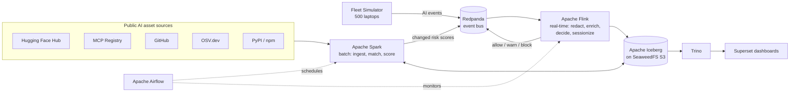

# AIRS-Lite: AI Asset Risk Lakehouse

> A real-time + batch data platform that **finds every AI tool being used inside a company, scores how risky each one is, catches sensitive data going into AI, and keeps a tamper-proof record of what happened.**

**Stack:** Apache Flink · Apache Spark · Apache Iceberg · Apache Airflow · Redpanda (Kafka-compatible) · SeaweedFS (S3) · Trino · Superset · Docker Compose

---

## Part 1: The project in plain language

### The world right now

Ten years ago, if a company wanted to know what software its employees were using, it was fairly easy: IT installed everything.

Today it's different. Any employee can, in under a minute:
- open ChatGPT, Claude or Gemini in a browser and paste a customer list into it,
- install an AI coding assistant (Cursor, Copilot, Cline) that can **read every file on their laptop**,
- connect an AI "agent" to the company database, Slack or Google Drive through a plug-in (called an **MCP server**) downloaded from the internet,
- run an AI model directly on their laptop, which never touches the company network at all.

Nobody asked IT. Nobody told security. This is called **"Shadow AI"**: AI that is running inside the company without anyone in charge knowing about it.

### Why that is a real problem

Picture a bank or a hospital.

| What happens | Why it hurts |
|---|---|
| An analyst uploads `finance_q3.xlsx` to a free chatbot to "make a summary" | Confidential financial data now sits on a third-party server. It may be stored, logged or used for training. |
| A developer pastes code with a database password into an AI tool | The password has leaked. Anyone who gets access to that tool's logs can get into the database. |
| An engineer installs an unknown MCP plug-in from GitHub | That plug-in can read files, run commands and send data out, and it acts *on its own* when the AI asks it to. |
| A popular AI Python package gets hacked (this really happened to LiteLLM in 2026) | Every laptop that installed the bad version starts leaking credentials within minutes. |
| The company pays for ChatGPT, Claude, Copilot *and* Gemini licences | Half of those licences are never used, and nobody can prove which ones. |

And when something *does* go wrong, the security team can't answer the basic questions: *Which AI tool was it? What data did it touch? Was that tool even allowed at the time? Who else is using it?*

Real examples: in 2023 Samsung engineers pasted confidential source code into ChatGPT, and the company then banned the tool. New laws like the **EU AI Act** now require companies to know and document which AI systems they use, with heavy fines if they don't.

### Why it matters

- **Data leaks are expensive.** One leak of customer or payment data can mean regulatory fines, lawsuits and lost trust.
- **Regulators now demand evidence.** "We didn't know" is no longer an acceptable answer under the EU AI Act, ISO 42001 or data-protection laws.
- **AI agents act by themselves.** A chatbot only *talks*. An agent *does things*: it runs code, queries databases, sends emails. A risky agent is like an unsupervised intern with admin keys.
- **Traditional security tools are blind to it.** Firewalls and antivirus weren't built to understand prompts, AI models or MCP servers, and a lot of AI runs entirely on the laptop where network tools can't see it.

### What we are building: a simple analogy

Think of **airport security, but for AI inside a company**.

| Airport | Our project |
|---|---|
| A list of known dangerous items and banned passengers | **The AI Risk Catalog**: a database of thousands of real AI models, agents and MCP plug-ins, each with a risk score (like a credit score, but for danger) |
| Scanners at every gate watching every passenger and bag | **The live event stream**: every AI action on every laptop (a prompt typed, a file uploaded, a tool called) flows into the system in real time |
| The officer who checks the list and decides "pass", "inspect" or "stop" | **The real-time decision engine (Flink)**: within milliseconds it checks the action against the catalog and the company's rules, then says **allow, warn or block** |
| Blurring faces and passport numbers on the CCTV footage | **Automatic redaction**: card numbers, emails, phone numbers and passwords are masked *before* anything is stored |
| CCTV recordings that can't be edited | **The tamper-proof audit log**: every block or warning is chained together like a blockchain, so any edit is detectable |
| The control room with screens and reports | **The dashboards**: what AI is in use, how risky the company is, which licences are wasted, and an investigation view for incidents |

### What it will do, step by step

1. **Every day**, it collects information about real AI tools from public sources (Hugging Face, the official MCP Registry, GitHub, vulnerability databases) and gives each one a **risk score from 0 to 10**.
2. **All the time**, it receives activity from a simulated company of 500 laptops: who used which AI tool, what they typed, which files they uploaded.
3. **For every action**, within a fraction of a second, it:
   - hides any sensitive data,
   - looks up how risky the AI tool is,
   - applies the company's rules ("never send card data to an unapproved AI"),
   - decides **allow / warn / block**.
4. **It stores everything** in a modern data lake (Apache Iceberg), cleaned and organised.
5. **It answers questions** on dashboards:
   - *"What AI tools are being used that we never approved?"* (Shadow AI)
   - *"Which department is carrying the most AI risk?"* (Risk posture)
   - *"Which AI licences are we paying for but nobody uses?"* (Saving money)
   - *"For this incident last Tuesday: what happened, step by step, and how risky was the tool **on that day**?"* (Investigation)
6. **It proves nothing was tampered with**, through the chained audit log.

### Who would use it
- **Security team:** sees threats and blocks them.
- **Compliance / legal:** gets evidence for auditors.
- **IT / finance:** cuts wasted AI spending.
- **Management:** gets a simple picture of how safely the company uses AI.

> This project is inspired by how AI-security companies such as [SuperAlign](https://superalign.ai) describe their platforms (Surface, AIRiskDB, Signal, Console). It is an independent learning project that rebuilds the **data engineering** side of that idea. It uses only public data and simulated company activity.

---

## Part 2: The project for engineers

| Capability | How it's built |
|---|---|
| Ingest AI asset metadata from 5 public sources | Spark batch jobs into Iceberg bronze, run by Airflow |
| Match the same asset across sources | Spark entity resolution (normalised keys + fuzzy matching) |
| Risk score per asset, kept as history | Spark scoring → SCD Type 2 `MERGE INTO` on Iceberg |
| Real-time event processing | Redpanda → Flink (watermarks, dedupe, broadcast-state enrichment, session windows) |
| Privacy | Flink redaction before anything is persisted |
| No lost or duplicated rows | Flink checkpoints + Iceberg sink (exactly-once) |
| Analytics | Spark SQL gold marts → Trino → Superset |
| Investigation using past scores | As-of joins on SCD2 + Iceberg time travel |
| Tamper-evident audit | SHA-256 hash-chained Iceberg table + nightly verification |
| Operations | Airflow DAGs for ingestion, marts, compaction, health checks and audit verification |

### High-level architecture



## Documentation

| Doc | What's inside |
|---|---|
| [01 – Problem & Solution](docs/01-problem-and-solution.md) | The problem in more depth, goals, non-goals, success criteria |
| [02 – Architecture](docs/02-architecture.md) | Full architecture, component diagrams, data flows, design decisions |
| [03 – Data Model](docs/03-data-model.md) | Event schemas, Redpanda topics, every Iceberg table |
| [04 – Pipelines](docs/04-pipelines.md) | Each Flink job, Spark job and Airflow DAG in detail |
| [05 – Risk Scoring](docs/05-risk-scoring.md) | The AIRS-Lite scoring method and the policy engine |
| [06 – Setup & Operations](docs/06-setup-and-operations.md) | Local environment, versions, how to run, monitoring, troubleshooting |
| [07 – Roadmap](docs/07-roadmap.md) | Phased build plan with acceptance criteria |
| [Company research](SuperAlign_DE_Project_Plan.md) | Research notes on SuperAlign and the original plan |

## Project status
| Phase | Status |
|---|---|
| 0 · Environment | ✅ Done: 13-service Docker stack; smoke test passes (Spark + Flink + Airflow write one Iceberg table, Trino/Superset read it) |
| 1 · Risk catalog | ✅ Done: 22,063 real AI assets (HF, MCP Registry, PyPI/npm, GitHub, OSV) resolved, scored, versioned (SCD2) and published to Redpanda by the `catalog_daily` DAG |
| 2 · Streaming pipeline | ✅ Done: 500 simulated laptops → Redpanda → Flink (redact, dedupe, enrich from the live catalog, allow/warn/block) → Iceberg. p95 latency 229 ms; catalog updates apply in seconds without a restart; exactly-once verified through crashes |
| 3 · Dashboards | ✅ Done: hourly Airflow `gold_marts` DAG (compaction → 6 Spark marts → 17 DQ checks) and 4 Superset dashboards built as code: Shadow AI (91% of shadow AI is invisible to network-only tools), Risk Posture with OWASP/NIST/EU AI Act evidence, AI ROI ($5.3k/month idle seats), Pipeline Health |
| 4 · Sessions + investigation | ⏭️ Next |
| 5 · Hardening & demos | Planned. See the [roadmap](docs/07-roadmap.md) |

### Quick start
```bash
cp .env.example .env
```
```bash
./airs.sh up
```
```bash
./airs.sh smoke
```
```bash
./airs.sh catalog
```
```bash
./airs.sh init && ./airs.sh build-flink && ./airs.sh submit-flink
```
```bash
./airs.sh simulate --rate 50 --duration 300 --scenarios rogue_mcp,finance_upload,secret_paste,poisoned_package
```
```bash
./airs.sh stream-check
```
```bash
./airs.sh gold && ./airs.sh dashboards
```
UIs: Airflow http://localhost:8088 · Flink http://localhost:8081 · Spark http://localhost:8082 · Redpanda Console http://localhost:8080 · Trino http://localhost:8085 · Superset http://localhost:8089 · SeaweedFS filer http://localhost:8888
