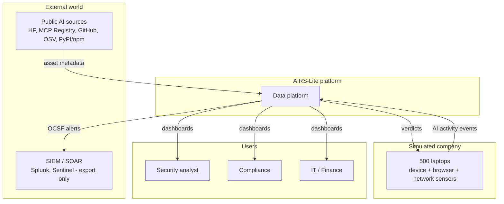
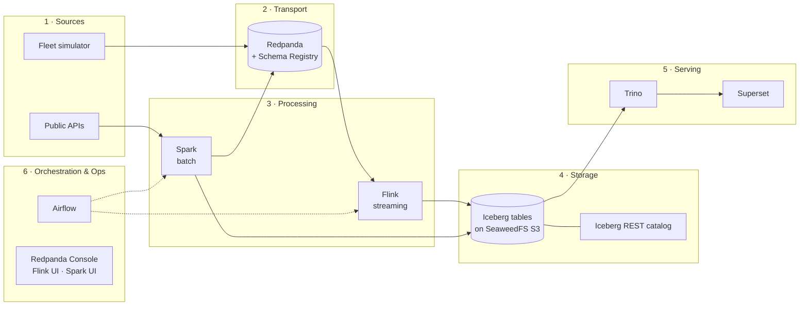
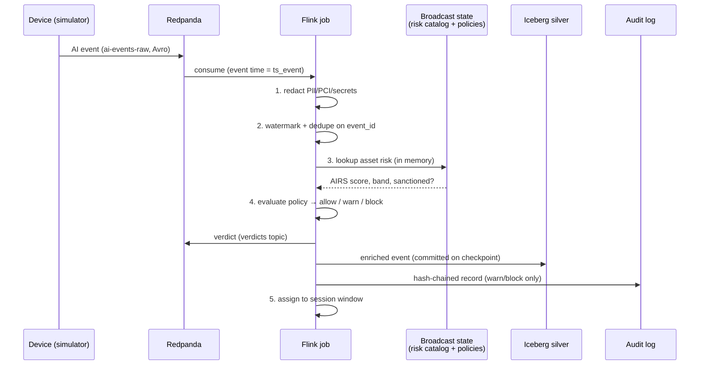
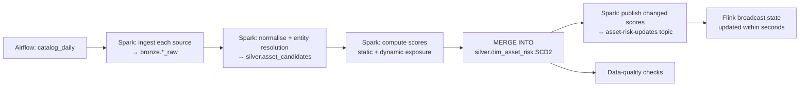
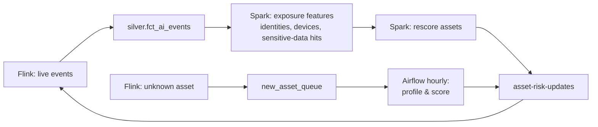

# 02 – Architecture

## 1. Architecture at a glance

AIRS-Lite follows a **Kappa-style streaming core with a batch intelligence layer**, and both share an **Iceberg lakehouse**.

```
 ┌──────────────── BATCH  (Airflow DAG: catalog_daily → SparkSubmit) ─────────────────┐
 │ Hugging Face Hub API ─┐                                                             │
 │ Official MCP Registry ┼─► Iceberg bronze ─► Spark: entity ─► Spark: AIRS scoring ─► │
 │ GitHub API (MCP repos)┤   (raw JSON)        resolution       (static + dynamic      │
 │ OSV.dev advisories    ┤                     → dim_asset       exposure from silver) │
 │ PyPI / npm metadata  ─┘                                              │              │
 │                         Iceberg: dim_asset_risk (SCD Type 2 via MERGE INTO)         │
 └──────────────────────────────────────────────────────────────┬──────────────────────┘
                     Spark publishes changed scores ───────────┐ │
                                                               ▼ │
 ┌──────────────────────────── STREAMING (Apache Flink) ─────────┼──────────────────────┐
 │ Fleet simulator ──► Redpanda topic      ┌─ Redpanda compacted topic                  │
 │ (500 devices,       ai-events-raw       │  asset-risk-updates → BROADCAST STATE      │
 │  device/browser/    (Avro, Schema       ▼                                            │
 │  network sensors,   Registry) ──► Flink job:                                         │
 │  offline bursts,                  1. PII/PCI redaction (regex + Luhn)                │
 │  dupes, late data)                2. event-time watermarks + dedupe (keyed state+TTL)│
 │                                   3. enrich with asset risk (broadcast join)         │
 │                                   4. policy verdict allow / warn / block             │
 │                                   5. session windows per identity+device             │
 │                                   6. very-late events → side output topic            │
 └───────────────┬──────────────────────────────┬────────────────────────┬──────────────┘
                 ▼                              ▼                        ▼
   Iceberg silver (Flink Iceberg sink,   Iceberg audit_log          Redpanda `verdicts`
   exactly-once via checkpoints):        (hash-chained)             → OCSF export for SIEM
   fct_ai_events, fct_sessions
                 │
                 ▼
   Airflow DAGs → Spark SQL gold marts, data-quality checks, Iceberg maintenance
                 │
                 ▼
   Trino + Superset dashboards (shadow AI, fleet risk, AI ROI, incident investigation)
```

## 2. System context



## 3. Layers and components



| Layer | Component | Responsibility |
|---|---|---|
| Sources | **Fleet simulator** (Python) | Produces realistic AI events from 500 devices: normal behaviour, attack scenarios, offline bursts, duplicates, clock skew |
| Sources | **Public APIs** | Hugging Face Hub, MCP Registry, GitHub, OSV.dev, PyPI/npm |
| Transport | **Redpanda** | A durable, ordered event log that speaks the Kafka API. Its Schema Registry enforces Avro contracts. |
| Processing | **Apache Flink** | Stateful real-time processing: redaction, dedupe, enrichment, policy, sessionization, exactly-once sinks |
| Processing | **Apache Spark** | Batch ingestion, entity resolution, scoring, SCD2 merges, gold marts, investigations, table maintenance |
| Storage | **Apache Iceberg on SeaweedFS (S3)** | ACID tables shared by Flink and Spark, with time travel, schema evolution and hidden partitioning |
| Storage | **Iceberg REST catalog** (pointers in PostgreSQL) | The single catalog Spark, Flink and Trino use, so table metadata stays consistent. Postgres, not SQLite, because Flink's two committers commit concurrently |
| Serving | **Trino + Superset** | Interactive SQL and dashboards on Iceberg |
| Orchestration | **Apache Airflow** | Schedules and monitors all batch work, maintenance and health checks |

## 4. Data flows

### 4.1 Real-time verdict path (hot path)



### 4.2 Risk intelligence path (batch)



### 4.3 Feedback loop: static plus dynamic scoring



Real-world usage feeds back into the scores. An asset that suddenly starts touching regulated data gets re-scored instead of staying frozen at its original score.

### 4.4 Analytics and investigation path

`silver` tables → Spark SQL (Airflow `gold_marts`, hourly) → `gold` tables → Trino → Superset.
Investigations run as a parameterised Spark job, or as Trino SQL using as-of joins and `FOR TIMESTAMP AS OF`.

## 5. Medallion layout in Iceberg

| Layer | Namespace | Written by | Contents |
|---|---|---|---|
| Bronze | `bronze` | Spark (sources), Flink (raw events, already redacted) | Source payloads, raw events |
| Silver | `silver` | Flink + Spark | Clean, deduplicated, enriched facts; asset dimension (SCD2); sessions; audit log |
| Gold | `gold` | Spark | Business marts for dashboards and exports |

Even bronze events are **redacted**. Raw prompt text is never written to disk (see [03 – Data Model](03-data-model.md)).

## 6. Key design decisions

| # | Decision | Alternatives considered | Why |
|---|---|---|---|
| D1 | **Redpanda** as the event bus | Apache Kafka, Apache Pulsar | Kafka API compatible (Flink's Kafka connector works unchanged), single binary with no ZooKeeper/KRaft to run, built-in Schema Registry and console, small footprint on a laptop |
| D2 | **Flink** for the real-time path | Spark Structured Streaming | True per-event processing in event time, rich keyed and broadcast state, session windows, side outputs for late data, low latency |
| D3 | **Spark** for batch | Flink batch, Python | Strong at large joins and fuzzy matching; the most complete Iceberg support (`MERGE INTO` and maintenance procedures) |
| D4 | **Iceberg** as the shared table format | Delta Lake, Hudi | Engine-neutral (first-class in Flink, Spark and Trino), hidden partitioning, time travel, safe concurrent writers |
| D5 | **Broadcast state** for catalog enrichment | Lookup per event to a database; Flink lookup join | No network call per event, so lookups are in-memory and fast. Updates arrive as a stream, so no restart is needed. The catalog fits in memory at laptop scale (see the scaling notes) |
| D6 | **SCD Type 2** for asset risk | Overwrite the latest score | Investigations need the score that was valid *at the time of the event* |
| D7 | **Redact inside Flink, before any sink** | Redact later in batch | Raw sensitive text must never touch disk: privacy by design |
| D8 | **Hash-chained audit table** | Plain append-only table | Tampering becomes detectable, which is what audit evidence needs |
| D9 | **Avro + Schema Registry** | JSON | Enforced contracts, compact messages, controlled schema evolution |
| D10 | **Airflow** for orchestration | Cron, Dagster | Industry standard; Spark operators, retries, SLAs, a clear UI |

## 7. Reliability and correctness

| Concern | Mechanism |
|---|---|
| Duplicate events | Flink keyed `ValueState` on `event_id` with a 48h TTL |
| Late events | Event-time watermarks (5 min out-of-orderness), allowed lateness of 24h for windows, later events go to the `late-events` side output |
| Crash recovery | Flink checkpoints every 20 s (RocksDB, incremental), retained on cancel; `submit-flink` resumes from the newest one. Redpanda offsets and the Iceberg commit are part of each checkpoint, which gives exactly-once (verified through crashes: topic records = bronze rows). Long-running containers use `restart: unless-stopped`. |
| Concurrent writes | Iceberg optimistic concurrency. Flink and Spark write *different* tables, except `dim_asset_risk`, which only Spark writes. |
| Small files from streaming | Nightly `rewrite_data_files` compaction, plus `expire_snapshots` and `remove_orphan_files` |
| Schema changes | Avro backward-compatible evolution; Iceberg column adds without rewriting data |
| Bad data | Malformed records go to a dead-letter topic `ai-events-dlq` |

## 8. Security and privacy

- **Redaction rules:** card numbers (regex + Luhn), emails, phone numbers, Indian PAN/Aadhaar patterns, API keys/tokens (known prefixes plus an entropy check), IBAN. Matches become `[REDACTED:PCI]` etc., and only *counts per entity type* are kept.
- **Least data:** prompt text is truncated to 500 characters after redaction; file contents are never captured (only name, extension, size and a sensitivity label).
- **Tamper evidence:** `audit_log.record_hash = SHA256(prev_hash ‖ canonical_json(record))`.
- **Secrets:** API tokens (GitHub, HF) live in a `.env` file excluded from git and are passed to containers as environment variables.

## 9. Scalability notes (beyond the laptop)

| Today (laptop) | At production scale |
|---|---|
| Catalog of about 10k–50k assets in broadcast state | 1M+ assets: keyed state on RocksDB partitioned by `asset_id`, or an external KV store with async I/O and a cache |
| 1 Flink TaskManager, a few hundred events/s | Scale out by partitioning on `device_id`; more Redpanda partitions |
| Single SeaweedFS node | S3 / GCS / ADLS |
| Iceberg REST catalog in a container | Managed catalog (AWS Glue, Polaris, Nessie) |
| Airflow LocalExecutor | Celery/Kubernetes executor |

## 10. Mapping to the inspiration (SuperAlign product concepts)

| AIRS-Lite component | Concept it mirrors |
|---|---|
| Fleet simulator (device / browser / network sensors) | Surface endpoint agent, browser extension, network sensor (Radar) |
| Risk catalog + AIRS-Lite score | AIRiskDB / AIRS score |
| Flink redaction | Redaction-aware capture / Prism |
| Flink policy engine | Sentinel detection and enforcement |
| Hash-chained audit log | Signal (immutable record) |
| Gold marts + Superset | Console |
