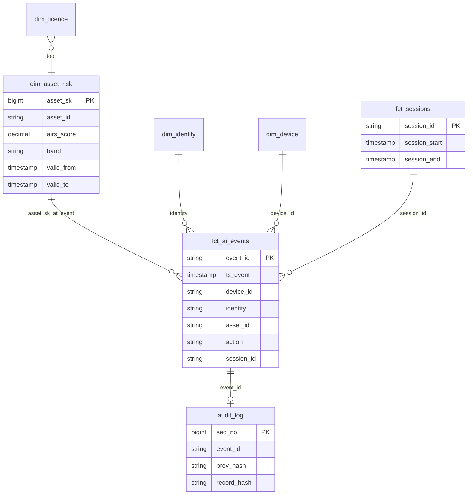

# 03 – Data Model

## 1. Redpanda topics

| Topic | Key | Value schema | Partitions | Cleanup | Producer → Consumer |
|---|---|---|---|---|---|
| `ai-events-raw` | `device_id` | `AiEvent` (Avro) | 6 | delete, 7d | Simulator → Flink |
| `asset-risk-updates` | `asset_id` | `AssetRiskUpdate` | 3 | **compact** | Spark → Flink (broadcast) |
| `policy-updates` | `policy_id` | `PolicyRule` | 1 | **compact** | CLI/Airflow → Flink (broadcast) |
| `verdicts` | `device_id` | `Verdict` | 6 | delete, 7d | Flink → simulator / SIEM export |
| `late-events` | `device_id` | `AiEvent` + `lateness_ms` | 3 | delete, 7d | Flink side output → Spark backfill |
| `new-assets` | `asset_ref` | `UnknownAsset` | 1 | delete, 7d | Flink → Airflow profiling DAG |
| `ai-events-dlq` | – | raw bytes + error | 1 | delete, 14d | Flink → manual inspection |

Compacted topics keep the **latest value per key**. When Flink starts, it reads the whole topic and rebuilds the complete catalog in broadcast state.

## 2. Event schemas (Avro)

### 2.1 `AiEvent`: one AI action on one device
| Field | Type | Example | Notes |
|---|---|---|---|
| `event_id` | string (UUID) | `8f2c-11…` | Idempotency key |
| `ts_event` | timestamp-millis | `2026-10-25T12:04:11Z` | When it happened on the device (**event time**) |
| `ts_sent` | timestamp-millis | `2026-10-25T15:20:00Z` | When it was sent (differs if the device was offline) |
| `device_id` | string | `WX-204` | |
| `os` | enum | `macos` / `windows` / `linux` | |
| `identity` | string | `m.chen@corp.example` | Simulated user |
| `department` | string | `finance` | |
| `sensor` | enum | `device` / `browser` / `network` | Which sensor saw it |
| `event_type` | enum | `asset_discovered`, `prompt`, `file_upload`, `paste`, `mcp_tool_call`, `model_inference`, `egress` | |
| `asset_ref` | string | `mcp:postgres-prod`, `app:chatgpt`, `model:llama-3-70b` | Raw reference; resolved to `asset_id` in Flink |
| `asset_version` | string, nullable | `1.82.7` | |
| `tool_name` | string, nullable | `query` | For MCP tool calls |
| `prompt_text` | string, nullable | `"Export the payments schema"` | **Redacted in Flink before any sink** |
| `file_name` | string, nullable | `finance_q3.xlsx` | Never file content |
| `file_size_bytes` | long, nullable | `183402` | |
| `dest_host` | string, nullable | `api.openai.com` | Network sensor |
| `bytes_out` | long, nullable | `1200000` | |
| `schema_version` | int | `1` | |

### 2.2 `AssetRiskUpdate` (implemented: [`schemas/asset_risk_update.avsc`](../schemas/asset_risk_update.avsc))
`asset_id, asset_name, category, airs_score, capability, exposure, governance, band, sanctioned (bool), aliases (array<string>), valid_from, reason`

### 2.3 `PolicyRule`
`policy_id, name, enabled, priority, condition (JSON DSL), action (allow|warn|block), updated_at`. See [05 – Risk Scoring](05-risk-scoring.md#5-policy-engine).

### 2.4 `Verdict`
`event_id, ts_event, device_id, identity, asset_id, airs_score, band, sensitive_types (array), policy_id, action, latency_ms`

## 3. Iceberg tables

Catalog: `airs` (REST catalog). Warehouse: `s3://warehouse/` on SeaweedFS (S3). File format: Parquet + ZSTD. Format version: 2.

### 3.1 Bronze

All catalog bronze tables (implemented in Phase 1) share one generic, append-only schema: `run_id, source, record_key, payload (raw JSON string), fetched_at, ingested_at`. Readers take the latest row per `(source, record_key)`.

| Table | Written by | Partitioning | Description |
|---|---|---|---|
| `bronze.hf_models_raw` | Spark | `days(ingested_at)` | Hugging Face Hub models (`source=hf_model`) and datasets (`hf_dataset`) |
| `bronze.mcp_registry_raw` | Spark | `days(ingested_at)` | MCP Registry entries (latest version), key = server name |
| `bronze.github_repos_raw` | Spark | `days(ingested_at)` | Repo metadata, key = `owner/repo` |
| `bronze.osv_advisories_raw` | Spark | `days(ingested_at)` | `osv_query` (vuln ids per `eco:name@version`) and `osv_vuln` (details per id) |
| `bronze.pkg_metadata_raw` | Spark | `days(ingested_at)` | PyPI (`source=pypi`) and npm (`npm`) metadata, key = package name |
| `bronze.ai_events` | Flink | `days(ts_event)`, `bucket(16, device_id)` | Every event as received, **already redacted**, plus `ingested_at`, `kafka_offset` |

### 3.2 Silver

**`silver.dim_asset_risk`**: SCD Type 2, written only by Spark

| Column | Type | Notes |
|---|---|---|
| `asset_sk` | bigint | Surrogate key per version |
| `asset_id` | string | Canonical ID, e.g. `mcp:modelcontextprotocol/server-postgres` |
| `asset_name` | string | |
| `category` | string | `mcp_server`, `model`, `dataset`, `package`, `agent`, `ai_service`, `extension` |
| `publisher` | string | |
| `licence` | string | |
| `source_systems` | array<string> | `[mcp_registry, github, npm]` |
| `aliases` | array<string> | All names seen for this asset |
| `capability` / `exposure` / `governance` | decimal(3,1) | 0–10 |
| `airs_score` | decimal(3,1) | Composite |
| `band` | string | `Critical` / `High` / `Medium` / `Low` |
| `score_reasons` | array<string> | Explainability, e.g. `["can execute code or shell commands (+4)", "not on the company allow-list (+2)"]` |
| `sanctioned` | boolean | From the company allow-list |
| `valid_from` / `valid_to` | timestamp | `valid_to = 9999-12-31` for the current version |
| `is_current` | boolean | |
| `row_hash` | string | Hash of the scored attributes, used for change detection |

Partitioning: `category`. Sort order: `asset_id, valid_from`.

**`silver.asset_candidates`**: one row per source record, after normalisation and enrichment (Phase 1)

`candidate_id, native_id, source, category, name, norm_name, description, publisher, licence, repo, package_key, declared_packages, version, popularity, stars, last_updated, archived, deprecated, is_remote, gated, pipeline_tag, capability_text, capability_tags, popularity_hint, vuln_ids, vuln_max_severity, malicious, built_at`. Rebuilt in full each run.

**`silver.asset_entity_map`**: `candidate_id → asset_id` with the `match_rule` that linked it (`self`, `declared_package`, `shared_repo`, `fuzzy_name`).

**`ops.pipeline_state`**: `component, key, value, updated_at`, used for the MCP backfill cursor, the incremental `updated_since` and the publish watermark.
**`ops.entity_resolution_metrics`**: precision and recall of the heuristic matching rules per run.
**`ops.dq_results`**: `run_at, suite, check_name, passed, detail` for every data-quality check.

**`silver.fct_ai_events`**: written by Flink

All `AiEvent` fields (prompt redacted), plus `asset_id`, `asset_sk_at_event`, `airs_score_at_event`, `band_at_event`, `sanctioned_at_event`, `sensitive_types` (array), `sensitive_count`, `policy_id`, `action`, `session_id`, `is_late` (bool), `ingested_at`.
Partitioning: `days(ts_event)`, `bucket(16, device_id)`.

**`silver.fct_sessions`**: written by Flink (session windows)

`session_id, identity, device_id, session_start, session_end, event_count, sensors_seen (array), assets_used (array), max_airs_score, sensitive_event_count, block_count, warn_count`.
Partitioning: `days(session_start)`.

**`silver.audit_log`**: written by Flink, append-only

`seq_no` (monotonic per partition), `event_id, ts_event, identity, device_id, asset_id, action, policy_id, reason, prev_hash, record_hash, written_at`.

**`silver.new_asset_queue`**: `asset_ref, first_seen, seen_count, devices (array), status (pending|profiled|unresolvable)`

**`silver.dim_identity`** / **`silver.dim_device`**: seeded by the simulator (department, role, OS, managed flag).

**`silver.dim_licence`**: simulated licence purchases (`tool, department, seats, cost_per_seat_month`), used for ROI.

### 3.3 Gold

| Table | Grain | Key metrics |
|---|---|---|
| `gold.shadow_ai` | asset × day | first_seen, devices, identities, `sanctioned=false`, `seen_only_on_device` (never by the network sensor), max band |
| `gold.fleet_risk_posture` | department × day | asset count by band, mean/max AIRS, sensitive events, blocks, warns |
| `gold.ai_roi` | tool × department × month | seats bought, active users, utilisation %, idle seats, idle cost, overlap flag |
| `gold.compliance_evidence` | asset (current) | AIRS dimensions, reasons, framework controls (OWASP LLM, NIST AI RMF, EU AI Act) |
| `gold.incident_timeline` | event within a session | Ordered timeline with the as-of risk context (built on demand per incident) |
| `gold.pipeline_health` | hour | events in, late %, dedupe count, unknown-asset %, p95 verdict latency |

## 4. Entity-relationship view

## 5. Schema evolution plan

| Change | How it's handled |
|---|---|
| Add an optional field to `AiEvent` (e.g. `agent_parent_id`) | Avro backward-compatible (default `null`); Flink consumer unchanged; `ALTER TABLE … ADD COLUMN` in Iceberg |
| Rename a column | Iceberg column IDs make the rename metadata-only, with no data rewrite |
| Change partitioning (e.g. hourly) | Iceberg partition evolution: new data uses the new spec and old files stay valid |
