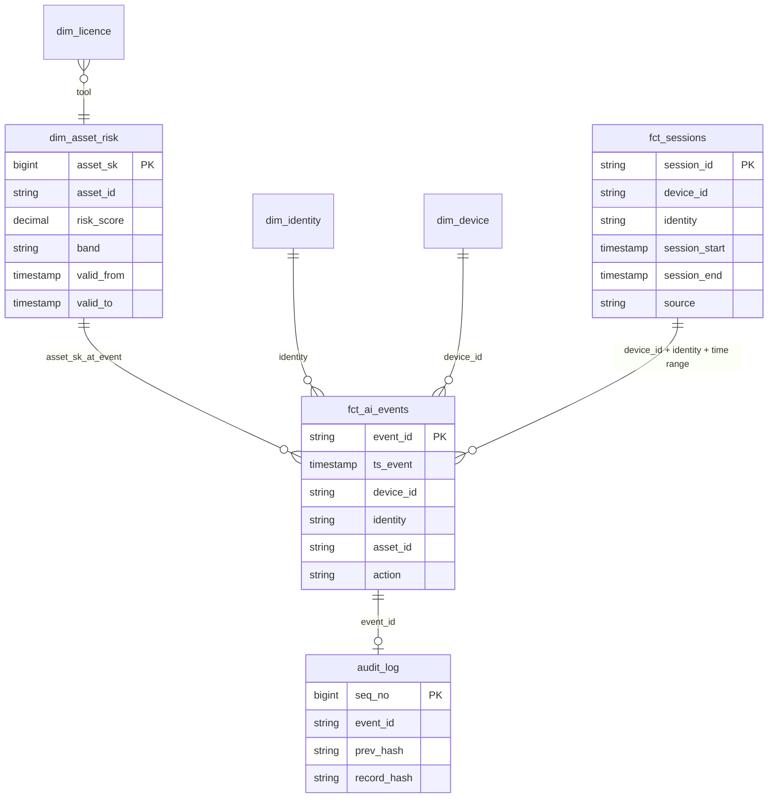

# 03 – Data Model

## 1. Redpanda topics

| Topic | Key | Value schema | Partitions | Cleanup | Producer → Consumer |
|---|---|---|---|---|---|
| `ai-events-raw` | `device_id` | `AiEvent` (Avro) | 6 | delete, 7d | Simulator → Flink |
| `asset-risk-updates` | `asset_id` | `AssetRiskUpdate` | 3 | **compact** | Spark → Flink (broadcast) |
| `policy-updates` | `policy_id` | `PolicyRule` (JSON) | 1 | **compact** | `./tracewell.sh policies` → Flink (broadcast) |
| `verdicts` | – | `Verdict` (JSON, transactional) | 6 | delete, 7d | Flink → simulator / SIEM export |
| `late-events` | – | JSON `event_id, ts_event, device_id, identity, lateness_ms` | 3 | delete, 7d | Flink session-window side output → Spark `late_event_backfill` |
| `new-assets` | – | `UnknownAsset` (JSON) | 1 | delete, 7d | Flink → Airflow profiling DAG (Phase 5) |
| `ai-events-dlq` | – | JSON: error + base64 raw bytes | 1 | delete, 14d | Flink → manual inspection |

Compacted topics keep the **latest value per key**. When Flink starts, it reads the whole topic and rebuilds the complete catalog in broadcast state.

## 2. Event schemas (Avro)

### 2.1 `AiEvent`: one AI action on one device
| Field | Type | Example | Notes |
|---|---|---|---|
| `event_id` | string (UUID) | `8f2c-11…` | Idempotency key |
| `ts_event` | timestamp-millis | `2026-10-25T12:04:11Z` | When it happened on the device (**event time**) |
| `ts_sent` | timestamp-millis | `2026-10-25T15:20:00Z` | When it was sent (differs if the device was offline) |
| `device_id` | string | `WX-204` | |
| `os` | enum | `macos` / `windows` / `linux` | |
| `identity` | string | `m.chen@corp.example` | Simulated user |
| `department` | string | `finance` | |
| `sensor` | enum | `device` / `browser` / `network` | Which sensor saw it |
| `event_type` | enum | `asset_discovered`, `prompt`, `file_upload`, `paste`, `mcp_tool_call`, `model_inference`, `egress` | |
| `asset_ref` | string | `mcp:postgres-prod`, `app:chatgpt`, `model:llama-3-70b` | Raw reference; resolved to `asset_id` in Flink |
| `asset_version` | string, nullable | `1.82.7` | |
| `tool_name` | string, nullable | `query` | For MCP tool calls |
| `prompt_text` | string, nullable | `"Export the payments schema"` | **Redacted in Flink before any sink** |
| `file_name` | string, nullable | `finance_q3.xlsx` | Never file content |
| `file_size_bytes` | long, nullable | `183402` | |
| `dest_host` | string, nullable | `api.openai.com` | Network sensor |
| `bytes_out` | long, nullable | `1200000` | |
| `schema_version` | int | `1` | |

### 2.2 `AssetRiskUpdate` (implemented: [`schemas/asset_risk_update.avsc`](../schemas/asset_risk_update.avsc))
`asset_id, asset_name, category, risk_score, capability, exposure, governance, band, sanctioned (bool), aliases (array<string>), valid_from, reason`

### 2.3 `PolicyRule` (JSON)
`policy_id, name, priority, enabled, action (allow|warn|block), when {sensitive_types_any, asset_sanctioned, asset_band_in, asset_known, event_type_in, tool_name_in, file_ext_in}`: the YAML from `policies/*.yaml` as JSON. See [05 – Risk Scoring](05-risk-scoring.md#5-policy-engine).

### 2.4 `Verdict` (JSON)
`event_id, ts_event, device_id, identity, event_type, asset_id, asset_known, risk_score, band, sanctioned, catalog_valid_from, sensitive_types, policy_id, action, latency_ms`

Avro is used for the high-volume event stream and the risk catalog, where Schema Registry contracts matter. The low-volume control and output topics use JSON for simplicity.

## 3. Iceberg tables

Catalog: `tracewell` (REST catalog). Warehouse: `s3://warehouse/` on SeaweedFS (S3). File format: Parquet + ZSTD. Format version: 2.

### 3.1 Bronze

All catalog bronze tables (implemented in Phase 1) share one generic, append-only schema: `run_id, source, record_key, payload (raw JSON string), fetched_at, ingested_at`. Readers take the latest row per `(source, record_key)`.

The curated catalog (`spark-jobs/catalog/seed/curated_assets.csv`: AI services, agents, extensions, MCP servers and local models) is versioned in git and read directly by `resolve_entities`, so it has no bronze table.

| Table | Written by | Partitioning | Description |
|---|---|---|---|
| `bronze.osv_advisories_raw` | Spark | `days(ingested_at)` | `osv_query` (vuln ids per `eco:name@version`) and `osv_vuln` (details per id) |
| `bronze.pkg_metadata_raw` | Spark | `days(ingested_at)` | PyPI (`source=pypi`) and npm (`npm`) metadata, key = package name |
| `bronze.ai_events` | Flink | `days(ts_event)`, `bucket(16, device_id)` | Every event as received, **already redacted**, plus `ingested_at`, `kafka_offset` |

### 3.2 Silver

**`silver.dim_asset_risk`**: SCD Type 2, written only by Spark

| Column | Type | Notes |
|---|---|---|
| `asset_sk` | bigint | Surrogate key per version |
| `asset_id` | string | Canonical ID, e.g. `mcp:postgres`, `model:mistralai/mistral-7b-instruct`, `pkg:pypi/litellm` |
| `asset_name` | string | |
| `category` | string | `mcp_server`, `model`, `package`, `agent`, `ai_service`, `extension` |
| `publisher` | string | |
| `licence` | string | |
| `source_systems` | array<string> | e.g. `[npm, seed]` for a curated MCP server merged with its npm package |
| `aliases` | array<string> | All names seen for this asset |
| `capability` / `exposure` / `governance` | decimal(3,1) | 0–10 |
| `risk_score` | decimal(3,1) | Composite |
| `band` | string | `Critical` / `High` / `Medium` / `Low` |
| `score_reasons` | array<string> | Explainability, e.g. `["can execute code or shell commands (+4)", "not on the company allow-list (+2)"]` |
| `sanctioned` | boolean | From the company allow-list |
| `valid_from` / `valid_to` | timestamp | `valid_to = 9999-12-31` for the current version |
| `is_current` | boolean | |
| `row_hash` | string | Hash of the scored attributes, used for change detection |

Partitioning: `category`. Sort order: `asset_id, valid_from`.

**`silver.asset_candidates`**: one row per source record, after normalisation and enrichment (Phase 1)

`candidate_id, native_id, source, category, name, norm_name, description, publisher, licence, repo, package_key, declared_packages, version, popularity, last_updated, archived, deprecated, is_remote, pipeline_tag, capability_text, capability_tags, popularity_hint, vuln_ids, vuln_max_severity, malicious, built_at`. Rebuilt in full each run.

**`silver.asset_entity_map`**: `candidate_id → asset_id` with the `match_rule` that linked it (`self`, `declared_package`, `shared_repo`, `fuzzy_name`).

**`ops.pipeline_state`**: `component, key, value, updated_at`, used for the publish watermark.
**`ops.entity_resolution_metrics`**: precision and recall of the heuristic matching rules per run.
**`ops.dq_results`**: `run_at, suite, check_name, passed, detail` for every data-quality check.

**`silver.fct_ai_events`**: written by Flink

One row per distinct `event_id` (DDL: [`sql/ddl/stream_tables.sql`](../sql/ddl/stream_tables.sql)): the `AiEvent` fields (prompt **redacted**), plus `asset_id`, `asset_known`, `asset_category`, `risk_score_at_event`, `band_at_event`, `sanctioned_at_event`, **`catalog_valid_from`** (which SCD2 version of the risk profile was used, so it links to `dim_asset_risk` for audits), `sensitive_types`, `sensitive_count`, `policy_id`, `action`, `latency_ms`, `processed_at`.
Partitioning: `day(ts_event)`, `bucket(device_id, 16)`. An event's session is found by `(device_id, identity)` and `ts_event BETWEEN session_start AND session_end` (sessions are only known once they end, after the event was written).

**`silver.fct_sessions`**: written by Flink (session windows) and repaired by Spark (Phase 4)

One row per activity session of one person on one device (DDL: [`sql/ddl/stream_tables.sql`](../sql/ddl/stream_tables.sql)): `session_id` (= `sha256(device_id|identity|start millis)[:16]`, the same in Flink and Spark), `identity, device_id, department, session_start, session_end` (first and last event), `duration_s, event_count, sensors_seen, event_types, assets_used` (arrays), `unknown_assets, max_risk_score, max_band, sensitive_events, blocks, warns, mb_out`, `source` (`stream` = Flink window, `backfill` = rebuilt by `late_event_backfill` after late events), `built_at`.
Partitioning: `day(session_start)`. Table property `write.merge.isolation-level=snapshot` so the backfill's MERGE can commit next to Flink's appends.
Invariants (checked by `./tracewell.sh session-check`): sessions of one person on one device never overlap; every settled event lies in exactly one session; each session's `event_count` equals its events in silver.

**`silver.audit_log`**: written by Flink, append-only

`seq_no` (monotonic per partition), `event_id, ts_event, identity, device_id, asset_id, action, policy_id, reason, prev_hash, record_hash, written_at`.

**`silver.new_asset_queue`**: `asset_ref, first_seen, seen_count, devices (array), status (pending|profiled|unresolvable)`

**`silver.dim_identity`** (`identity, department`) / **`silver.dim_device`** (`device_id, identity, department`): the simulated company's HR directory (300 people) and device inventory (500 laptops). Exported once by `simulator.py --export-directory` (deterministic: same seed, same company) into `spark-jobs/gold/seed/`, loaded by the `load_reference` task. Used for ROI: only people in the directory fill a seat.

**`silver.dim_licence`**: simulated licence purchases from `spark-jobs/gold/seed/licences.csv` (`tool_id, tool_name, function, department, seats, cost_per_seat_month`), used for ROI. `function` groups tools that do the same job (`chat_assistant`, `coding_assistant`), which is how overlap is detected.

### 3.3 Gold

Built hourly by the `gold_marts` DAG ([04 Part F](04-pipelines.md#part-f-gold-marts-phase-3-implemented)) and read live by Superset through Trino. Every table has a `built_at` column. Code: [`spark-jobs/gold/marts.py`](../spark-jobs/gold/marts.py).

| Table | Grain | Partition | Key columns |
|---|---|---|---|
| `gold.shadow_ai` | asset × day | `day` | `asset_name, category` (`unknown` = not in the catalog), `current_band, current_risk_score, max_band_at_event, first_seen, is_new, devices, identities, departments, events, sensitive_events, blocks, warns, mb_out, files_touched, seen_only_on_device` (no network sensor saw it that day) |
| `gold.fleet_risk_posture` | department × day | `day` | `events, active_people, active_devices, distinct_assets, assets_{critical,high,medium,low,unknown}` (each asset once, at its worst band), `mean_risk_score, max_risk_score, high_risk_events, high_risk_event_pct, unsanctioned_events, sensitive_events, blocks, warns` |
| `gold.policy_hits` | day × policy × department × asset | `day` | `policy_name, action, hits, devices, people, first_hit, last_hit, event_types, files, sensitive_types, mb_out` |
| `gold.ai_roi` | tool × department × month | `month` | `seats, cost_per_seat_month, active_users` (directory people only), `utilisation_pct, idle_seats, idle_cost, users_without_seat, monthly_cost, overlap, overlapping_tools` |
| `gold.compliance_evidence` | asset (current version) | none | risk dimensions, `score_reasons`, `owasp_llm, nist_ai_rmf, eu_ai_act` (arrays), `evidence` (one line per triggered control and the signal behind it), `in_use_30d, devices_30d, events_30d, sensitive_events_30d, last_seen, profile_valid_from` |
| `gold.pipeline_health` | hour | `day` | `records_in, resends_dropped, events_out, late_events, late_pct, unknown_asset_events, unknown_asset_pct, dlq_records, dlq_pct, sensitive_events, blocks, warns, latency_p50_ms, latency_p95_ms, latency_p99_ms, latency_max_ms` |
| `gold.investigations` | investigation | – | One row per `./tracewell.sh investigate` run: `investigation_id, session_id, device_id, identity, session_start/end, events, assets_changed_since, events_changed_since, tt_agreement_pct, tt_unexplained, recorded_vs_asof_diffs, risky_assets, max_blast_devices, created_at` |
| `gold.incident_timeline` | event within an investigated session | – | `seq, ts_event, event_type, asset, action, policy_id`, risk **enforced** (`score/band/sanctioned_recorded`), **SCD2 as-of** (`*_asof`, `asof_valid_from`), **time travel** (`*_tt`, `tt_snapshot_id, tt_committed_at`), **today** (`*_today`), `changed_since_event, tt_agrees, mismatch_reason` |
| `gold.incident_blast_radius` | risky asset of an investigated session | – | `devices, people, departments, events, sensitive_events, blocks, first_seen, last_seen` over the last 30 days, `band_today, score_today` |

## 4. Entity-relationship view

## 5. Schema evolution plan

| Change | How it's handled |
|---|---|
| Add an optional field to `AiEvent` (e.g. `agent_parent_id`) | Avro backward-compatible (default `null`); Flink consumer unchanged; `ALTER TABLE … ADD COLUMN` in Iceberg |
| Rename a column | Iceberg column IDs make the rename metadata-only, with no data rewrite |
| Change partitioning (e.g. hourly) | Iceberg partition evolution: new data uses the new spec and old files stay valid |
