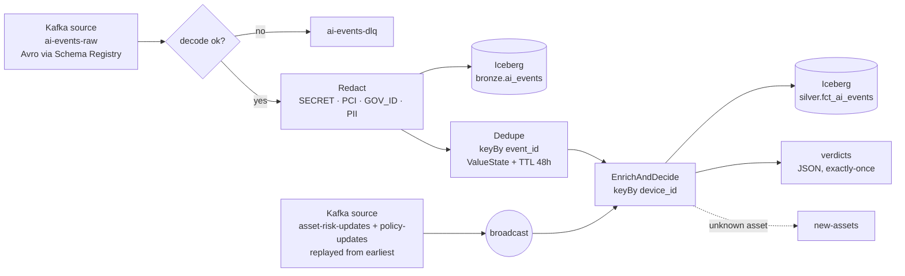
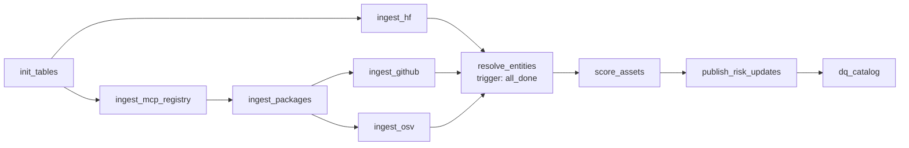
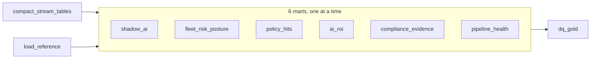

# 04 – Pipelines

This doc covers every job in the platform: what it reads, what it does, what it writes, and how it fails safely.

---

## Part A: Fleet simulator (Python, implemented)

Code: `simulator/` (image `airs/simulator`, compose profile `stream`). Run it with `./airs.sh simulate [args]`.

**Realistic by construction.** At start-up the simulator reads the live risk catalog from the compacted `asset-risk-updates` topic and "installs" a realistic subset on every laptop: all curated AI services, agents and extensions, all seed packages, 40 models, and 120 MCP servers (30 of them High-risk), chosen by department. Every event therefore refers to a real asset. 40% of references use an alias (package key, lower-case name, repo slug) instead of the canonical id, as a real sensor would report it.

| Setting (flag) | Default |
|---|---|
| Devices / people (`--devices`, `--people`) | 500 / 300, across engineering, finance, sales, hr, support, legal |
| Rate (`--rate`) | 50 events/s |
| Offline (`--offline-rate`) | a device can go offline for 1–10 min (scaled-down hours) and then flushes its buffered events with their original `ts_event` |
| Duplicates (`--duplicate-rate`) | 1%: the same event is resent with the same `event_id` |
| Clock skew | ±2 min on about 3% of devices |
| Unknown assets (`--unknown-rate`) | 2% of events reference MCP servers that aren't in the catalog |
| Sensitive data (`--sensitive-rate`) | 4% of prompts and 8% of pastes contain fake emails, phone numbers, Luhn-valid test card numbers, AWS/OpenAI-style keys, or PAN/Aadhaar numbers |

**Scenarios** (`--scenarios`, injected after `--scenario-after` seconds):

| Scenario | What happens | Verdict observed |
|---|---|---|
| `poisoned_package` | 3 engineering laptops install `pypi:chromadb` (open critical advisory) | **block** (P002, Critical) |
| `secret_paste` | A developer pastes an AWS key into Claude Code (unsanctioned) | **block** (P003) |
| `finance_upload` | An analyst uploads `finance_q3.xlsx` to DeepSeek Chat (unsanctioned) | **warn** (P006) |
| `rogue_mcp` | An unknown MCP server appears, reads `customers.csv`, sends 48 MB to an unknown host | **warn** (P007) + reported on `new-assets` |

Output: Confluent-framed Avro on `ai-events-raw` (schema `schemas/ai_event.avsc`, registered as `ai-events-raw-value`), key = `device_id`. A background consumer prints Flink's live verdict counts and every block.

Helpers in the same image: `init_topics.py` (all topics + schema, run by `./airs.sh init`) and `publish_policies.py` (`policies/*.yaml` → compacted `policy-updates`, with tombstones for removed rules).

---

## Part B: Flink streaming job `airs-stream` (Java, implemented)

Code: `flink-jobs/airs-stream/` (Maven; `./airs.sh build-flink` builds and unit-tests it inside a Maven container, `./airs.sh submit-flink` submits it and resumes from the latest checkpoint).

### B.1 Operator graph



### B.2 Steps

| Step | Logic |
|---|---|
| **Decode** | Confluent wire format: the writer schema is fetched from the Schema Registry by id and cached, so producers can evolve the schema without redeploying. Bad records go to `ai-events-dlq` (with the error and raw bytes); the deserializer never throws. |
| **Watermarks** | Bounded out-of-orderness of 5 min on `ts_event`, idleness 1 min. The control stream emits the maximum watermark so it never holds back event time after the broadcast join. |
| **Redact** | `Redactor`: ordered regex detectors (secrets, then Luhn-checked card numbers, then PAN/Aadhaar, then emails and phones). Matches become `[REDACTED:<TYPE>]`; only the categories and the count are kept. Runs **before** the first sink. |
| **Bronze sink** | Every redacted copy, duplicates included, so dedupe can be audited. |
| **Dedupe** | Keyed by `event_id`; the first copy passes and resends are dropped (`events_deduped` metric). |
| **Enrich & decide** | Broadcast state holds every asset's current profile, an **alias index** (any reference → `asset_id`) and the policies. Tombstones remove retired assets. Events resolve their `asset_ref`; unknown assets get a provisional High profile and are reported once per device. Policies are evaluated in priority order; the first match wins, default allow. `latency_ms = verdict time − ts_sent`. |
| **Warm-up** | After a fresh start the catalog (about 22k assets) is replayed from the compacted topic. Events arriving before it has loaded are **parked** in keyed state and released by a timer, so they aren't misjudged as "unknown". |
| **Sinks** | Iceberg bronze and silver through the Table API on the same job graph (committed on every checkpoint, exactly-once); `verdicts` through a transactional Kafka sink (exactly-once); `new-assets` and DLQ at-least-once. |

### B.3 Runtime configuration

| Setting | Value |
|---|---|
| Checkpoints | Every 20 s, exactly-once, RocksDB incremental, `s3://checkpoints/flink`, **retained on cancel** |
| Restart | Flink default for checkpointed jobs (exponential delay) |
| Parallelism | 2 (laptop); TaskManager 1.5 GB process memory, 4 slots |
| Packaging | The Kafka connector, Avro and Jackson are bundled in the job jar; Flink runtime, Table API and Iceberg come from the cluster |

### B.4 Measured results (26 Oct 2026, 50 events/s, laptop)

| What | Result |
|---|---|
| Latency, device send → verdict | **p50 130 ms · p95 229 ms · p99 710 ms** · max 1.6 s |
| Catalog change → verdicts change, no restart | **3.7 s** from the update landing in Redpanda to the first verdict on the new profile (includes waiting for the next event about that asset); 0 old-profile verdicts afterwards |
| Dedupe | 0 duplicate `event_id`s in silver |
| Privacy | 0 raw secrets, cards, emails, phones or government IDs in bronze or silver |
| Enrichment | 98.4% of events resolved; the 1.6% unknown matches the planned unknown rate |
| Exactly-once under failure | Topic: 57,313 records → bronze: 57,313 rows; silver: 56,803 = distinct events, 0 duplicates. This survived ~20 failed catalog commits, a catalog migration, a storage OOM crash and a resume from checkpoint |

### B.5 What broke on the way (and the fix)

| Problem | Cause | Fix |
|---|---|---|
| Job failed: `NoSuchMethodError` in Jackson | Avro pulled an older `jackson-core` than `jackson-databind` needs (Maven nearest-wins) | Import `jackson-bom` in `dependencyManagement` |
| `SQL parse failed. Encountered "identity"` | `identity` is a reserved word in Flink SQL | Quote it with backticks |
| Iceberg commits failed with HTTP 500 | The REST catalog stored pointers in **SQLite**; the bronze and silver committers commit at the same moment on every checkpoint (`SQLITE_BUSY`, then `SQLITE_BUSY_SNAPSHOT` with WAL) | Catalog moved to **PostgreSQL** (custom `airs/iceberg-rest` image with the JDBC driver); existing table pointers migrated row by row; the SQLite file kept as a backup |
| Catalog requests hung; Spark publish hung | **SeaweedFS was OOM-killed** (400 MB) under checkpoints + commits + a Spark job at once | SeaweedFS 1 GB; `restart: unless-stopped` on all long-running services; Kafka AdminClient timeouts in the publisher |
| Job lost when the JobManager container was recreated | No HA; checkpoints are only kept on failure | `RETAIN_ON_CANCELLATION` and `./airs.sh submit-flink` resumes from the newest checkpoint that has `_metadata` |
| Shaded `flink-sql-connector-kafka` in the cluster | It relocates Kafka classes, so DataStream code can't read record keys (needed for tombstones) | Removed from the image; the connector is bundled in the job jar |

---

## Part C: Spark batch jobs (Phase 1: risk catalog, implemented)

Code lives in `spark-jobs/catalog/`. Every job runs with `spark-submit` against the Iceberg REST catalog, from Airflow or by hand. HTTP calls run on the driver with a thread pool; all transformation logic is Spark column expressions in `transforms.py`.

| Job | Reads | Writes | What it does |
|---|---|---|---|
| `init_tables.py` | – | all `bronze`/`silver`/`ops` tables | Idempotent DDL |
| `ingest_hf.py` | HF Hub API | `bronze.hf_models_raw` | Top 3,000 models + 1,000 datasets by downloads; cursor pagination via the `Link` header; only the fields needed (`expand[]=`) |
| `ingest_mcp_registry.py` | MCP Registry API | `bronze.mcp_registry_raw` | **Resumable backfill** (≤ 60 pages per run, cursor saved in `ops.pipeline_state`, a bronze commit every 20 pages), then **incremental** pulls with `updated_since`. Latest version only |
| `ingest_packages.py` | PyPI JSON, npm registry + search API | `bronze.pkg_metadata_raw` | Seed AI packages + every npm/PyPI package an MCP server declares; skips packages fetched in the last 3 days; README bodies stripped |
| `ingest_github.py` | GitHub REST API | `bronze.github_repos_raw` | Repos linked from MCP servers (first) and packages; 50 per run without `GITHUB_TOKEN`, 3,000 with one; skips repos fetched in the last 7 days |
| `ingest_osv.py` | OSV `querybatch` + `vulns/{id}` | `bronze.osv_advisories_raw` | Advisories affecting **the version in use** of each package (re-queried daily); details fetched once per vulnerability id |
| `resolve_entities.py` | all bronze + seeds | `silver.asset_candidates`, `silver.asset_entity_map`, `ops.entity_resolution_metrics` | Normalise each source, enrich with GitHub + OSV, resolve entities (C.1) |
| `score_assets.py` | candidates + entity map + seeds | `silver.dim_asset_risk` | Aggregate per asset, AIRS-Lite score ([05](05-risk-scoring.md)), hybrid SCD1/SCD2 `MERGE` (C.2) |
| `publish_risk_updates.py` | `dim_asset_risk` | Redpanda `asset-risk-updates` | New versions since the last watermark → Avro in Confluent wire format, key = `asset_id`; **tombstones** (null value) for retired assets; creates the compacted topic if missing; registers the schema |
| `dq_catalog.py` | silver, bronze | `ops.dq_results` | 16 checks; fatal failures fail the task (C.4) |

**Bronze design:** every bronze table has the same generic schema (`run_id, source, record_key, payload JSON, fetched_at, ingested_at`), is append-only, and is partitioned by `days(ingested_at)`. Readers take the latest record per `(source, record_key)`. Re-ingesting is always safe, and full history is kept.

### C.1 Entity resolution
1. **Normalise:** `norm_name()` lowercases, drops the scope or reverse-DNS namespace (`@scope/`, `io.github.owner/`), strips MCP affixes (`mcp-server-`, `server-`, `-mcp`, `-mcp-server`) and keeps `[a-z0-9]`. Repo URLs of any form (`git+https`, `git@github.com:`, `/tree/main/...`) become `owner/repo`. PyPI names follow PEP 503.
2. **Link rules** (MCP servers ↔ npm/PyPI packages):
   - `declared_package`: the registry entry lists the package identifier. This is ground truth.
   - `shared_repo`: same GitHub repo, with a **monorepo guard**. It only applies when the repo hosts exactly one MCP server and at most one package per ecosystem. `modelcontextprotocol/servers` hosts dozens of servers and must never merge them.
   - `fuzzy_name`: Levenshtein similarity ≥ 0.9 on normalised names (≥ 4 chars), blocked by the first 3 characters, only when the name is **unique on both sides**, **and** the link is plausible: the package is an MCP package (its name contains "mcp") or shares a publisher or repo owner with the server.
3. **One server per package:** each package keeps only its best edge (declared > shared repo > fuzzy). Every edge joins one MCP server to one package, so this guarantees no component ever contains two MCP servers.
4. **Connected components** by label propagation in Spark. Each node takes the smallest label among itself and its neighbours; labels are prefixed by priority (MCP server < package), so the canonical asset is the MCP server.
5. **Evaluation:** the heuristic rules (2 + 3) are scored against rule 1 as ground truth, for MCP servers that declare packages. Results go to `ops.entity_resolution_metrics`.

**Current build (3rd DAG run, 25 Oct 2026):** 25,266 candidates → **22,063 assets** (3,203 packages merged into their MCP server). Heuristics vs declared links: **precision 0.999, recall 0.77** (2,487 TP, 3 FP, 754 FN).

**What real data taught us.** Each of these bugs was found by inspecting results, then fixed and covered by a unit test or DQ check:

| Problem found | Example | Fix |
|---|---|---|
| Monorepos | `modelcontextprotocol/servers` hosts dozens of servers | Shared-repo guard (`test_monorepo_guard_blocks_shared_repo`) |
| Similar names are not the same thing | Picsart's `gen-ai` MCP server merged with Google's `@google/genai` SDK | Plausibility guard on fuzzy matches (`test_fuzzy_needs_more_than_a_similar_name`) |
| Transitive chaining | Server A declares a package that server B fuzzy-matched, so A and B became one asset | One-server-per-package pruning (`test_each_package_attaches_to_one_server`) plus DQ check `max_one_mcp_server_per_asset` |
| Assets that disappear | A package merged into a server kept its old row marked current | `WHEN NOT MATCHED BY SOURCE` retires it; Redpanda gets a **tombstone**; DQ check `current_assets_match_resolution` |

The precision metric did **not** catch the `gen-ai` false merge, because it only judges servers that declare packages. A metric only covers the cases it can see, so spot-checking merged clusters by hand is still needed.

### C.2 SCD Type 2 merge (hybrid with Type 1)
- **Type 2 (new version):** a `row_hash` over the scored attributes (capability, exposure, governance, score, band, sanctioned, licence, reasons). When it changes, the current row is closed (`valid_to = run time`) and a new row is inserted.
- **Type 1 (in place):** name, description, version, popularity, aliases and sources are updated on the current row when they change. A download count going up is not a risk event.

```sql
MERGE INTO airs.silver.dim_asset_risk t
USING (
  SELECT s.asset_id AS merge_key, s.* FROM staged s
  UNION ALL
  SELECT NULL AS merge_key, s.* FROM staged s            -- second copy of changed rows = new version
  JOIN airs.silver.dim_asset_risk c ON c.asset_id = s.asset_id AND c.is_current AND c.row_hash <> s.row_hash
) s
ON t.asset_id = s.merge_key AND t.is_current
WHEN MATCHED AND t.row_hash <> s.row_hash THEN UPDATE SET t.valid_to = s.valid_from, t.is_current = false
WHEN MATCHED AND (NOT (t.popularity <=> s.popularity) OR ...) THEN UPDATE SET t.popularity = s.popularity, ...
WHEN NOT MATCHED THEN INSERT *
WHEN NOT MATCHED BY SOURCE AND t.is_current THEN UPDATE SET t.valid_to = <run time>, t.is_current = false
```

- **Retirement:** current rows for assets that resolution no longer produces are closed (`WHEN NOT MATCHED BY SOURCE AND t.is_current`). If the asset reappears later, it gets a new version after a gap.

Verified: the first run inserted 10,058 versions; a re-score after recalibration closed and re-inserted 10,008; an unchanged re-run inserted **0** and closed **0**; a wrongly merged package was retired and then revived as its own asset once the fuzzy rule was fixed.

### C.3 Point-in-time investigation (Phase 4)
```sql
SELECT e.ts_event, e.sensor, e.event_type, e.asset_id, e.action,
       r.airs_score AS score_at_event, r.band AS band_at_event, r.sanctioned AS sanctioned_at_event,
       cur.airs_score AS score_today
FROM airs.silver.fct_ai_events e
JOIN airs.silver.dim_asset_risk r
  ON r.asset_id = e.asset_id
 AND e.ts_event >= r.valid_from AND e.ts_event < r.valid_to      -- as-of join
JOIN airs.silver.dim_asset_risk cur
  ON cur.asset_id = e.asset_id AND cur.is_current
WHERE e.session_id = :session_id
ORDER BY e.ts_event;

-- Cross-check with Iceberg time travel
SELECT * FROM airs.silver.dim_asset_risk FOR TIMESTAMP AS OF :incident_ts WHERE asset_id = :asset_id;
```

### C.4 Catalog data-quality checks (`dq_catalog.py`)
Fatal: ≥ 5,000 current assets · exactly one current version per asset · no overlapping SCD2 versions · scores within 0–10 · band matches score · every candidate mapped to an asset · at most one MCP server per asset · current assets = resolved assets · catalog built within 26 h.
Warning / info: every score has at least one reason · SCD2 gaps (retired and later reappeared) · each bronze source ingested within 26 h.

---

## Part D: Airflow DAGs

### D.1 `catalog_daily` (implemented)



- Schedule `0 2 * * *`, `max_active_runs=1`, `max_active_tasks=2`; each Spark app is capped at 1 core so two tasks share the 2-core worker.
- Package, GitHub and OSV ingestion depend on what the registry lists, hence the order.
- `resolve_entities` uses `trigger_rule=all_done`. If one API is down, bronze still holds that source's last good data, so the catalog is still built and the DQ bronze-freshness warning flags the stale source.
- Retries: 2 with exponential backoff (none for `dq_catalog`: a failed check must not be retried away). Timeout 1 h per task.
- Every task is a `SparkSubmitOperator` (client mode, driver in the Airflow container) with `common.py` and `transforms.py` shipped as `--py-files`.

Run it once now: `./airs.sh catalog`.

### D.2 `gold_marts` (implemented)



- Schedule `15 * * * *` (hourly at :15), `max_active_runs=1`, `max_active_tasks=1` (one Spark app at a time: see F.5), each Spark app capped at 1 core. Run timeout 50 min.
- Retries: 2 with a 1-minute delay (none for `dq_gold`). Each task is a `SparkSubmitOperator` running `spark-jobs/gold/*.py` with `common.py` and `marts.py` as `--py-files`.
- Details and measurements: [Part F](#part-f-gold-marts-phase-3-implemented).

Run it once now: `./airs.sh gold`.

### D.3 Planned DAGs (later phases)

| DAG | Schedule | Tasks | Failure handling |
|---|---|---|---|
| `new_asset_profiling` | hourly | read queue → profile → score → publish | Unresolvable after 3 tries → `status=unresolvable`, band stays `High` |
| `late_event_backfill` | hourly at :45 | `backfill_late_events` | – |
| `iceberg_maintenance` | 03:30 daily | expire snapshots → remove orphans → full compaction (hourly compaction of recent partitions already runs in `gold_marts`) | Runs after `catalog_daily` |
| `audit_verify` | 04:00 daily | `verify_audit_chain` | Failure = **critical alert** |
| `flink_job_health` | every 15 min | Flink REST: job RUNNING? checkpoint < 2 min old? Redpanda lag OK? | Alert; optional resubmit from the latest checkpoint |

---

## Part E: Data-quality checks

| Check | Table | Rule |
|---|---|---|
| No raw PII | `silver.fct_ai_events`, `bronze.ai_events` | 0 rows match card/email/key regexes in `prompt_text` |
| Catalog freshness | `dim_asset_risk` | max(`valid_from`) within the last 26 h |
| Single current version | `dim_asset_risk` | exactly 1 `is_current` row per `asset_id` |
| SCD continuity | `dim_asset_risk` | no gaps or overlaps between versions |
| Referential integrity | `fct_ai_events` | ≥ 98% of events have a resolved `asset_id` |
| Completeness | `fct_ai_events` vs Redpanda | row count ≈ topic offset delta minus dedupes and DLQ |
| Score range | `dim_asset_risk` | all scores between 0 and 10, band consistent with score |

Implemented as Spark assertions inside Airflow tasks (Great Expectations or Soda optional).

---

## Part F: Gold marts (Phase 3, implemented)

Code: [`spark-jobs/gold/`](../spark-jobs/gold/) (marts are pure DataFrame functions in `marts.py`, unit-tested in `tests/gold/`), DAG [`airflow/dags/gold_marts.py`](../airflow/dags/gold_marts.py), dashboards as code in [`dashboards/build_dashboards.py`](../dashboards/build_dashboards.py). Table columns: [03 §3.3](03-data-model.md#33-gold).

### F.1 Jobs

| Script / task | Reads | Writes | What it does |
|---|---|---|---|
| `compact_stream_tables.py` | `silver.fct_ai_events`, `bronze.ai_events` | same tables | `rewrite_data_files` on the last 2 days: merges the ~13 KB files Flink's 20 s commits leave behind (one afternoon: **3,325 files → 144**; an hour of traffic: 272 → 16). Safe next to Flink: rewrites files, not rows, and commits optimistically |
| `build_gold.py --mart reference` | `seed/*.csv` | `silver.dim_licence`, `dim_identity`, `dim_device` | Atomic `createOrReplace` of the reference tables |
| `build_gold.py --mart <mart>` | silver + reference | `gold.<mart>` | Rebuilds whole UTC days (`--days 2`: today and yesterday; months for `ai_roi`) and **overwrites only those partitions** (`overwritePartitions`), so reruns are idempotent and late events land in the next run. A column added to a mart is added to the table first (`ALTER TABLE … ADD COLUMN`, Iceberg schema evolution) |
| `dq_gold.py` | gold + silver | `ops.dq_results` (suite `gold`) | 17 checks (F.3); a fatal failure fails the task |

### F.2 What each mart answers

| Mart | Question | Notes |
|---|---|---|
| `shadow_ai` | Which AI is in use that nobody approved, and could a network-only tool even see it? | Unsanctioned **or unknown** assets; `seen_only_on_device` = no network-sensor event that day; `mb_out` and `files_touched` make exfiltration stand out (the rogue MCP: 48 MB, `customers.csv`) |
| `fleet_risk_posture` | How risky is the AI each department actually uses? | Each asset counted once at its worst band of the day, so averages are per asset, not per event |
| `policy_hits` | What did the policies block or warn on, and why? | Policy names come from `policies/*.yaml`, the same rules Flink enforces |
| `ai_roi` | Are we paying for seats nobody uses, or for two tools that do the same job? | Active users are counted against the HR directory only; `users_without_seat` shows demand beyond what was bought |
| `compliance_evidence` | Which framework controls apply to each asset, and on what evidence? | Crosswalk in [05 §6](05-risk-scoring.md#6-framework-crosswalk-for-goldcompliance_evidence); all 22,063 current assets, flagged `in_use_30d` |
| `pipeline_health` | Is the real-time path healthy, hour by hour? | Hours with no traffic get a row with 0 events, so an outage is visible rather than skipped |

### F.3 Gold data-quality checks (`dq_gold.py`)
Fatal: posture reconciles with silver (for each day, the mart's event count lies between the silver rows processed 2 min before the build and those processed by the build: Flink commits every 20 s, so this is exact without a race) · unique keys in all six marts · ROI seat arithmetic (`idle + active − without_seat = seats`) · compliance covers every current asset · every High/Critical asset in use has at least one mapped control · every shadow-AI row is backed by an unsanctioned or unknown event · no raw PII in silver for the window.
Warning (SLOs from [06 §6](06-setup-and-operations.md#6-monitoring)): worst hourly p95 latency < 1 s · late < 5% · unknown assets < 2% · DLQ < 0.1% · stream processed an event within 15 min.

### F.4 Dashboards (Superset, built by `./airs.sh dashboards`)

The Trino connection, 11 datasets (4 physical tables + 7 SQL views for "latest day/month" and unnesting arrays), 35 charts and 4 dashboards are created through the Superset REST API and matched by name, so rerunning updates them in place. Superset queries Trino live (no cache), so each hourly DAG run is visible on the next refresh (dashboards auto-refresh every 10 min).

| Dashboard | URL | Shows |
|---|---|---|
| Shadow AI | http://localhost:8089/superset/dashboard/shadow-ai/ | KPIs (shadow assets, new today, % seen only on the endpoint, unknown to the catalog), by category × band, visibility, AI the catalog has never seen, most widespread shadow AI |
| Fleet Risk Posture | http://localhost:8089/superset/dashboard/risk-posture/ | High-risk share, blocks, warns, sensitive events; assets by band per department; verdicts per department; policy hits by rule and the newest hits; mean/max AIRS; in-use assets per OWASP LLM risk; compliance evidence table |
| AI ROI | http://localhost:8089/superset/dashboard/ai-roi/ | Spend, idle seat cost, utilisation, overlaps; utilisation by tool × department; idle cost by tool; licences vs usage |
| Pipeline Health | http://localhost:8089/superset/dashboard/pipeline-health/ | Latency p95, throughput, late %, unknown % (with trend lines); latency percentiles (log scale); throughput; lateness/unknown/DLQ; latest `dq_gold` results |

### F.5 What broke on the way (and the fix)

| Problem | Cause | Fix |
|---|---|---|
| Each mart took ~4 min for a few hundred rows | Flink's 20 s commits had left 3,325 files of ~13 KB in silver; every job opened all of them | `compact_stream_tables` as the DAG's first task |
| `ValidationException: Deleted manifest … could not be found` | `rewrite_manifests` raced Flink, whose merge-append also rewrites manifests on every commit | Dropped: Flink's merge-append already bounds the manifest count |
| `INSERT_COLUMN_ARITY_MISMATCH` on `shadow_ai` | Two columns were added to the mart after the table existed | Automatic `ADD COLUMN` before writing (schema evolution) |
| Two marts in parallel took ~5.5 min each, one alone ~1.5 min | The 8 GB Docker VM ran out of RAM and swap (memory "full" stall ~40%) with two Spark drivers + executors next to the always-on stack | `max_active_tasks=1` |
| `list >> list` dependency error | Airflow can't set dependencies between two lists | `cross_downstream([compact, reference], marts)` |
| Each simulator run invented a new company (unseeded names: 1,770 "people" for 500 laptops) | Faker was not seeded | Seeded people + an exported HR directory; ROI counts directory people only |
