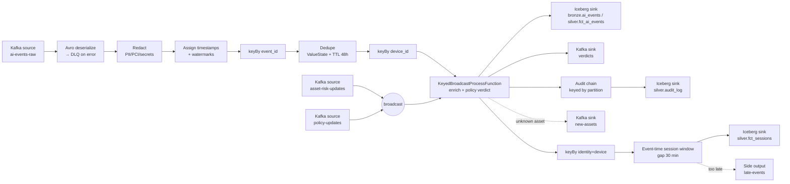
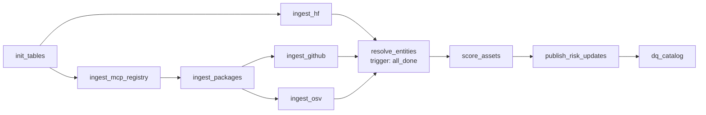

# 04 – Pipelines

This doc covers every job in the platform: what it reads, what it does, what it writes, and how it fails safely.

---

## Part A: Fleet simulator (Python)

**Purpose:** create realistic AI activity for a fake company.

| Setting | Default |
|---|---|
| Devices / identities | 500 / 300 |
| Departments | engineering, finance, sales, hr, support, legal |
| Event rate | 50–500 events/s (configurable) |
| Offline devices | 5% go offline for 1–24 h, then flush their buffered events |
| Duplicate rate | 1% resent with the same `event_id` |
| Clock skew | ±2 min on 3% of devices |
| Unknown assets | 2% of events reference assets that aren't in the catalog |
| Sensitive data | 4% of prompts/pastes contain fake PII, Luhn-valid test card numbers or fake API keys |

**Scripted attack scenarios** (toggled with flags):
1. **Rogue MCP:** an engineer installs `mcp:unknown-7f`, which calls `read_file` on `customers.csv` and then sends data to an unknown host.
2. **Finance upload:** an analyst uploads `finance_q3.xlsx` to an unsanctioned chatbot.
3. **Poisoned package:** devices update to an AI package version that has an OSV advisory.
4. **Secret paste:** a developer pastes a code block containing an API key into a browser AI app.

Output: Avro to `ai-events-raw`, keyed by `device_id`. It also consumes `verdicts` and logs what "would have been blocked."

---

## Part B: Flink streaming job `airs-stream`

### B.1 Operator graph



### B.2 Steps in detail

| # | Operator | Logic | State |
|---|---|---|---|
| 1 | **Deserialize** | Avro via Schema Registry; on failure write to `ai-events-dlq` | – |
| 2 | **Redact** | Regex detectors + Luhn check (cards) + entropy check (secrets). Replace matches with `[REDACTED:<TYPE>]`, emit `sensitive_types`, `sensitive_count` | Stateless |
| 3 | **Watermarks** | `forBoundedOutOfOrderness(5 min)` on `ts_event`, with idleness of 1 min so quiet partitions don't stall | – |
| 4 | **Dedupe** | First `event_id` passes; repeats are dropped and counted in a metric | `ValueState<Boolean>`, TTL 48h |
| 5 | **Enrich** | Normalise `asset_ref` → look up `asset_id` via an alias map in broadcast state → attach score, band and sanctioned flag. If not found: provisional `High`, emit to `new-assets` | Broadcast `MapState<alias, AssetRisk>` |
| 6 | **Policy** | Evaluate enabled rules in priority order; the first match wins; the default is `allow`. Record `latency_ms = now − ingest_ts` | Broadcast `MapState<policy_id, Rule>` |
| 7 | **Audit chain** | For `warn`/`block`: `record_hash = SHA256(prev_hash ‖ json)`; `prev_hash` is kept per audit partition | `ValueState<String>` |
| 8 | **Sessionize** | `EventTimeSessionWindows.withGap(30 min)`, `allowedLateness(24 h)`, `sideOutputLateData` | Window state |
| 9 | **Sinks** | Iceberg `FlinkSink` (upsert off, append), committed on checkpoint; Kafka sinks with `EXACTLY_ONCE` delivery | – |

### B.3 Runtime configuration
| Setting | Value |
|---|---|
| Checkpoint interval | 30 s, exactly-once, at most 1 concurrent |
| State backend | RocksDB, incremental checkpoints to `s3://checkpoints/` |
| Restart strategy | Fixed delay: 5 attempts, 10 s |
| Parallelism | 2 (laptop) |
| Language | Java 17 (recommended) or PyFlink 1.20 |

### B.4 Metrics exported
`events_in`, `events_deduped`, `events_late`, `events_dlq`, `unknown_asset_ratio`, `verdict_latency_p95`, `blocks`, `warns`, plus checkpoint duration and size (Flink UI / REST API).

---

## Part C: Spark batch jobs (Phase 1: risk catalog, implemented)

Code lives in `spark-jobs/catalog/`. Every job runs with `spark-submit` against the Iceberg REST catalog, from Airflow or by hand. HTTP calls run on the driver with a thread pool; all transformation logic is Spark column expressions in `transforms.py`.

| Job | Reads | Writes | What it does |
|---|---|---|---|
| `init_tables.py` | – | all `bronze`/`silver`/`ops` tables | Idempotent DDL |
| `ingest_hf.py` | HF Hub API | `bronze.hf_models_raw` | Top 3,000 models + 1,000 datasets by downloads; cursor pagination via the `Link` header; only the fields needed (`expand[]=`) |
| `ingest_mcp_registry.py` | MCP Registry API | `bronze.mcp_registry_raw` | **Resumable backfill** (≤ 60 pages per run, cursor saved in `ops.pipeline_state`, a bronze commit every 20 pages), then **incremental** pulls with `updated_since`. Latest version only |
| `ingest_packages.py` | PyPI JSON, npm registry + search API | `bronze.pkg_metadata_raw` | Seed AI packages + every npm/PyPI package an MCP server declares; skips packages fetched in the last 3 days; README bodies stripped |
| `ingest_github.py` | GitHub REST API | `bronze.github_repos_raw` | Repos linked from MCP servers (first) and packages; 50 per run without `GITHUB_TOKEN`, 3,000 with one; skips repos fetched in the last 7 days |
| `ingest_osv.py` | OSV `querybatch` + `vulns/{id}` | `bronze.osv_advisories_raw` | Advisories affecting **the version in use** of each package (re-queried daily); details fetched once per vulnerability id |
| `resolve_entities.py` | all bronze + seeds | `silver.asset_candidates`, `silver.asset_entity_map`, `ops.entity_resolution_metrics` | Normalise each source, enrich with GitHub + OSV, resolve entities (C.1) |
| `score_assets.py` | candidates + entity map + seeds | `silver.dim_asset_risk` | Aggregate per asset, AIRS-Lite score ([05](05-risk-scoring.md)), hybrid SCD1/SCD2 `MERGE` (C.2) |
| `publish_risk_updates.py` | `dim_asset_risk` | Redpanda `asset-risk-updates` | New versions since the last watermark → Avro in Confluent wire format, key = `asset_id`; **tombstones** (null value) for retired assets; creates the compacted topic if missing; registers the schema |
| `dq_catalog.py` | silver, bronze | `ops.dq_results` | 16 checks; fatal failures fail the task (C.4) |

**Bronze design:** every bronze table has the same generic schema (`run_id, source, record_key, payload JSON, fetched_at, ingested_at`), is append-only, and is partitioned by `days(ingested_at)`. Readers take the latest record per `(source, record_key)`. Re-ingesting is always safe, and full history is kept.

### C.1 Entity resolution
1. **Normalise:** `norm_name()` lowercases, drops the scope or reverse-DNS namespace (`@scope/`, `io.github.owner/`), strips MCP affixes (`mcp-server-`, `server-`, `-mcp`, `-mcp-server`) and keeps `[a-z0-9]`. Repo URLs of any form (`git+https`, `git@github.com:`, `/tree/main/...`) become `owner/repo`. PyPI names follow PEP 503.
2. **Link rules** (MCP servers ↔ npm/PyPI packages):
   - `declared_package`: the registry entry lists the package identifier. This is ground truth.
   - `shared_repo`: same GitHub repo, with a **monorepo guard**. It only applies when the repo hosts exactly one MCP server and at most one package per ecosystem. `modelcontextprotocol/servers` hosts dozens of servers and must never merge them.
   - `fuzzy_name`: Levenshtein similarity ≥ 0.9 on normalised names (≥ 4 chars), blocked by the first 3 characters, only when the name is **unique on both sides**, **and** the link is plausible: the package is an MCP package (its name contains "mcp") or shares a publisher or repo owner with the server.
3. **One server per package:** each package keeps only its best edge (declared > shared repo > fuzzy). Every edge joins one MCP server to one package, so this guarantees no component ever contains two MCP servers.
4. **Connected components** by label propagation in Spark. Each node takes the smallest label among itself and its neighbours; labels are prefixed by priority (MCP server < package), so the canonical asset is the MCP server.
5. **Evaluation:** the heuristic rules (2 + 3) are scored against rule 1 as ground truth, for MCP servers that declare packages. Results go to `ops.entity_resolution_metrics`.

**Current build (3rd DAG run, 25 Oct 2026):** 25,266 candidates → **22,063 assets** (3,203 packages merged into their MCP server). Heuristics vs declared links: **precision 0.999, recall 0.77** (2,487 TP, 3 FP, 754 FN).

**What real data taught us.** Each of these bugs was found by inspecting results, then fixed and covered by a unit test or DQ check:

| Problem found | Example | Fix |
|---|---|---|
| Monorepos | `modelcontextprotocol/servers` hosts dozens of servers | Shared-repo guard (`test_monorepo_guard_blocks_shared_repo`) |
| Similar names are not the same thing | Picsart's `gen-ai` MCP server merged with Google's `@google/genai` SDK | Plausibility guard on fuzzy matches (`test_fuzzy_needs_more_than_a_similar_name`) |
| Transitive chaining | Server A declares a package that server B fuzzy-matched, so A and B became one asset | One-server-per-package pruning (`test_each_package_attaches_to_one_server`) plus DQ check `max_one_mcp_server_per_asset` |
| Assets that disappear | A package merged into a server kept its old row marked current | `WHEN NOT MATCHED BY SOURCE` retires it; Redpanda gets a **tombstone**; DQ check `current_assets_match_resolution` |

The precision metric did **not** catch the `gen-ai` false merge, because it only judges servers that declare packages. A metric only covers the cases it can see, so spot-checking merged clusters by hand is still needed.

### C.2 SCD Type 2 merge (hybrid with Type 1)
- **Type 2 (new version):** a `row_hash` over the scored attributes (capability, exposure, governance, score, band, sanctioned, licence, reasons). When it changes, the current row is closed (`valid_to = run time`) and a new row is inserted.
- **Type 1 (in place):** name, description, version, popularity, aliases and sources are updated on the current row when they change. A download count going up is not a risk event.

```sql
MERGE INTO airs.silver.dim_asset_risk t
USING (
  SELECT s.asset_id AS merge_key, s.* FROM staged s
  UNION ALL
  SELECT NULL AS merge_key, s.* FROM staged s            -- second copy of changed rows = new version
  JOIN airs.silver.dim_asset_risk c ON c.asset_id = s.asset_id AND c.is_current AND c.row_hash <> s.row_hash
) s
ON t.asset_id = s.merge_key AND t.is_current
WHEN MATCHED AND t.row_hash <> s.row_hash THEN UPDATE SET t.valid_to = s.valid_from, t.is_current = false
WHEN MATCHED AND (NOT (t.popularity <=> s.popularity) OR ...) THEN UPDATE SET t.popularity = s.popularity, ...
WHEN NOT MATCHED THEN INSERT *
WHEN NOT MATCHED BY SOURCE AND t.is_current THEN UPDATE SET t.valid_to = <run time>, t.is_current = false
```

- **Retirement:** current rows for assets that resolution no longer produces are closed (`WHEN NOT MATCHED BY SOURCE AND t.is_current`). If the asset reappears later, it gets a new version after a gap.

Verified: the first run inserted 10,058 versions; a re-score after recalibration closed and re-inserted 10,008; an unchanged re-run inserted **0** and closed **0**; a wrongly merged package was retired and then revived as its own asset once the fuzzy rule was fixed.

### C.3 Point-in-time investigation (Phase 4)
```sql
SELECT e.ts_event, e.sensor, e.event_type, e.asset_id, e.action,
       r.airs_score AS score_at_event, r.band AS band_at_event, r.sanctioned AS sanctioned_at_event,
       cur.airs_score AS score_today
FROM airs.silver.fct_ai_events e
JOIN airs.silver.dim_asset_risk r
  ON r.asset_id = e.asset_id
 AND e.ts_event >= r.valid_from AND e.ts_event < r.valid_to      -- as-of join
JOIN airs.silver.dim_asset_risk cur
  ON cur.asset_id = e.asset_id AND cur.is_current
WHERE e.session_id = :session_id
ORDER BY e.ts_event;

-- Cross-check with Iceberg time travel
SELECT * FROM airs.silver.dim_asset_risk FOR TIMESTAMP AS OF :incident_ts WHERE asset_id = :asset_id;
```

### C.4 Catalog data-quality checks (`dq_catalog.py`)
Fatal: ≥ 5,000 current assets · exactly one current version per asset · no overlapping SCD2 versions · scores within 0–10 · band matches score · every candidate mapped to an asset · at most one MCP server per asset · current assets = resolved assets · catalog built within 26 h.
Warning / info: every score has at least one reason · SCD2 gaps (retired and later reappeared) · each bronze source ingested within 26 h.

---

## Part D: Airflow DAGs

### D.1 `catalog_daily` (implemented)



- Schedule `0 2 * * *`, `max_active_runs=1`, `max_active_tasks=2`; each Spark app is capped at 1 core so two tasks share the 2-core worker.
- Package, GitHub and OSV ingestion depend on what the registry lists, hence the order.
- `resolve_entities` uses `trigger_rule=all_done`. If one API is down, bronze still holds that source's last good data, so the catalog is still built and the DQ bronze-freshness warning flags the stale source.
- Retries: 2 with exponential backoff (none for `dq_catalog`: a failed check must not be retried away). Timeout 1 h per task.
- Every task is a `SparkSubmitOperator` (client mode, driver in the Airflow container) with `common.py` and `transforms.py` shipped as `--py-files`.

Run it once now: `./airs.sh catalog`.

### D.2 Planned DAGs (later phases)

| DAG | Schedule | Tasks | Failure handling |
|---|---|---|---|
| `new_asset_profiling` | hourly | read queue → profile → score → publish | Unresolvable after 3 tries → `status=unresolvable`, band stays `High` |
| `gold_marts` | hourly at :15 | `build_gold_shadow_ai`, `…_risk_posture`, `…_ai_roi`, `…_compliance`, `…_pipeline_health` → DQ | Idempotent partition overwrite |
| `late_event_backfill` | hourly at :45 | `backfill_late_events` | – |
| `iceberg_maintenance` | 03:30 daily | compact → rewrite manifests → expire snapshots → remove orphans | Runs after `catalog_daily` |
| `audit_verify` | 04:00 daily | `verify_audit_chain` | Failure = **critical alert** |
| `flink_job_health` | every 15 min | Flink REST: job RUNNING? checkpoint < 2 min old? Redpanda lag OK? | Alert; optional resubmit from the latest checkpoint |

---

## Part E: Data-quality checks

| Check | Table | Rule |
|---|---|---|
| No raw PII | `silver.fct_ai_events`, `bronze.ai_events` | 0 rows match card/email/key regexes in `prompt_text` |
| Catalog freshness | `dim_asset_risk` | max(`valid_from`) within the last 26 h |
| Single current version | `dim_asset_risk` | exactly 1 `is_current` row per `asset_id` |
| SCD continuity | `dim_asset_risk` | no gaps or overlaps between versions |
| Referential integrity | `fct_ai_events` | ≥ 98% of events have a resolved `asset_id` |
| Completeness | `fct_ai_events` vs Redpanda | row count ≈ topic offset delta minus dedupes and DLQ |
| Score range | `dim_asset_risk` | all scores between 0 and 10, band consistent with score |

Implemented as Spark assertions inside Airflow tasks (Great Expectations or Soda optional).
