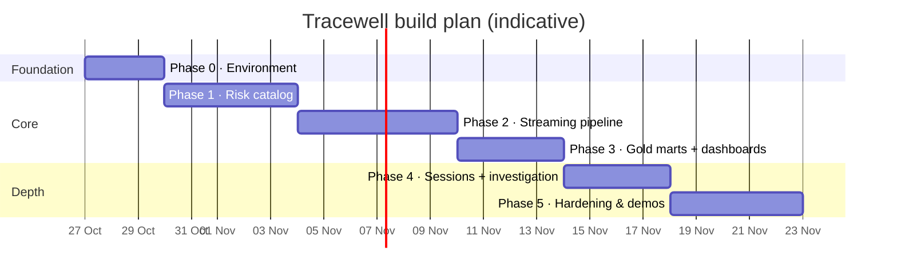

# 07 – Roadmap

Each phase ends with something that **runs end to end** and a checklist that proves it.

## Phase 0: Environment
**Build:** Docker Compose with Redpanda, SeaweedFS (S3), the Iceberg REST catalog, Flink, Spark, Airflow, Trino and Superset. Add the `tracewell.sh` helper and `.env.example`.
**Status: ✅ done (25 Oct 2026)**
- [x] All services are healthy with one command (`./tracewell.sh up`)
- [x] Spark creates an Iceberg table, Flink appends to it, and Trino reads both writes
- [x] Airflow runs a hello-world `SparkSubmitOperator` DAG (`hello_spark_iceberg`)
- [x] Extra checks: Superset → Trino query, Redpanda produce/consume, catalog survives a restart, smoke test can be re-run

**Measured:** all 13 containers together use about 4.2 GB of RAM (Docker limit 8 GB). A full smoke run takes about 4 minutes.

## Phase 1: Risk catalog (Spark + Iceberg + Airflow)
**Build:** ingestion jobs, entity resolution, Tracewell risk scoring, the SCD2 merge, and the `catalog_daily` DAG.
**Status: ✅ done (25 Oct 2026)**
- [x] Every asset in `silver.dim_asset_risk` has a score, band and reasons: first built with **22,063 assets** from 5 public sources; since 28 Oct 2026 **20,011 assets** from a curated catalog plus npm/PyPI discovery (see the change note below)
- [x] A second run with changed data creates new SCD2 versions (old version closed, one current row); an unchanged run creates none; retired assets are closed and tombstoned
- [x] Entity-resolution precision and recall reported every run (against declared package links instead of a hand-labelled sample): **precision 0.999, recall 0.77** on the full registry
- [x] Data-quality checks pass in Airflow: all fatal ones green (16 checks then, 13 now)
- [x] Extra: scores published to the compacted Redpanda topic `asset-risk-updates` (Avro, Schema Registry), ready for Flink in Phase 2; 31 unit tests

**Measured:** a full DAG run takes about 27 min on a slow home connection (most of it is the package API calls). The MCP Registry backfill resumes 6,000 servers per run (18,000 so far).
**Known limits (then):** without a `GITHUB_TOKEN` only 50 repos were enriched per run; registry descriptions are short, so keyword-based capability signals were rough; exposure is static until Phase 2 adds fleet telemetry.

**Change (28 Oct 2026): curated sources and the Tracewell name.** Bulk ingestion from Hugging Face, the MCP Registry and GitHub was removed. MCP servers and local models now come from a reviewed list in `seed/curated_assets.csv` (each MCP server names its repo and package, so entity resolution still links it to its npm/PyPI package), next to PyPI/npm metadata and OSV advisories. The project was renamed from AIRS-Lite to **Tracewell** everywhere: Iceberg catalog `tracewell`, Java package `ai.tracewell.stream`, `tracewell.sh`, Docker project `tracewell`, and `risk_score` columns. The stack was rebuilt from empty volumes: the catalog DAG built 88 assets in 8 min (65 Low, 6 Medium, 16 High, 1 Critical) with all fatal DQ checks green; Flink resolved all 88 assets in the stream (p95 212 ms, 1.99% unknown); `gold_marts` passed 17/17 checks; the offline-burst laptop again gave exactly its 4 expected sessions; 0 overlapping sessions and 0 mismatches over 13,115 settled events; an investigation of a session using Shell Runner, Desktop Commander and Kubernetes MCP servers showed 100% time-travel agreement; 45 pytest and 15 JUnit tests pass. The same day, package discovery on npm and PyPI brought the catalog to **20,011 assets** (12,012 npm, 7,963 PyPI, 48 curated; 438 High, 6 Critical) in a 22-min DAG run, with Flink p95 still 211 ms and `gold_marts` 17/17 green; 48 pytest tests.

## Phase 2: Streaming pipeline (Redpanda + Flink + Iceberg)
**Build:** the simulator, Avro schemas, and the Flink job (redact → dedupe → enrich with broadcast state → policy → sinks). Spark publishes scores to `asset-risk-updates`.
**Status: ✅ done (26 Oct 2026)**
- [x] Events flow into `silver.fct_ai_events` with scores and verdicts: 98.4% resolved against 22,063 catalog assets
- [x] 0 raw PII found by the no-PII check (secrets, cards, emails, phones, PAN/Aadhaar), in bronze and silver
- [x] Duplicates are removed: 0 duplicate event_ids in silver
- [x] Changing a score changes verdicts without restarting Flink: **3.7 s** from the update landing in Redpanda to the first verdict on the new profile, and 0 verdicts on the old profile after it landed
- [x] p95 verdict latency measured: **p50 130 ms · p95 229 ms · p99 710 ms** (device send → verdict, 50 events/s)
- [x] Extra: **exactly-once under real failure.** After ~20 failed catalog commits, a catalog migration, a storage OOM crash and a resume from checkpoint, bronze held exactly the 57,313 records in the topic and silver exactly the 56,803 distinct events
- [x] Extra: 13 JUnit tests (redaction, policies), 4 attack scenarios verified (poisoned package, card/secret leaks, finance upload, rogue MCP)

## Phase 3: Gold marts + dashboards (Spark + Airflow + Trino + Superset)
**Build:** the `gold_marts` DAG and 4 Superset dashboards (Shadow AI, Risk Posture, AI ROI, Pipeline Health).
**Status: ✅ done (26 Oct 2026)**
- [x] Dashboards update hourly from Airflow: `gold_marts` runs at :15 (scheduled runs verified); 9 tasks, ~12 min, every partition overwrite idempotent; Superset reads the marts live through Trino
- [x] The scripted scenarios are visible on the dashboards: the rogue MCP server appears under *AI the catalog has never seen* (1 device, 48 MB out, `customers.csv`); the finance upload appears as a P006 hit for finance → DeepSeek Chat with `finance_q3.xlsx`; the poisoned package (chromadb, Critical) heads the compliance evidence table
- [x] Extra: 6 marts (`shadow_ai`, `fleet_risk_posture`, `policy_hits`, `ai_roi`, `compliance_evidence`, `pipeline_health`), 17 `dq_gold` checks, 7 new unit tests (38 pytest in total), dashboards as code (`./tracewell.sh dashboards`: 11 datasets, 35 charts)
- [x] Extra: hourly compaction of the stream tables (silver 3,325 files → 144) and automatic schema evolution of the marts

**Measured (simulated fleet, 26 Oct):** 226 shadow AI assets in a day, **91% of them never seen by a network sensor** (endpoint-only); 7 assets unknown to the catalog; 227 assets in use, 42 of them High/Critical; licences $12,010/month with $5,277 idle (54% utilisation) and 5 engineers using Cursor without a seat. The Pipeline Health dashboard shows the 06:00 UTC recovery hour (p95 ≈ 20 min while Flink replayed the backlog after the storage crash) against p95 ≈ 200 ms in normal hours.

## Phase 4: Sessions + investigation (Flink + Spark + Iceberg time travel)
**Build:** session windows, the late-event side output and backfill, `investigate.py`, and an Investigation dashboard.
**Status: ✅ done (26 Oct 2026)**
- [x] An offline device flushing 12 h of events produces correct sessions: the simulator's `offline_burst` laptop sent 201 events from 4 work periods at once; all were late for Flink's windows, and the Spark backfill produced exactly the 4 expected sessions (start, end to the millisecond, event counts)
- [x] An investigation shows *score at event time* vs *score today*, plus blast radius: a Cursor session from its half hour as High/unsanctioned shows High then vs Medium today, the enforcement lag (2 events Flink judged before it received the update), and Cursor's blast radius (47 devices, 187 people)
- [x] Time-travel results agree with the SCD2 as-of join: 0 unexplained mismatches; the only differences are events inside the 84 s between a version's `valid_from` and its commit, each labelled
- [x] Extra: every settled event in exactly one session (0 mismatches over 279,581 events), 0 overlaps, idempotent backfill; a real watermark bug from Phase 2 found and fixed; Investigation dashboard with an investigation picker; 2 JUnit + 6 pytest tests (15 JUnit, 44 pytest in total)

## Phase 5: Hardening & demos
**Build:** the hash-chained audit log + `audit_verify`, the `iceberg_maintenance` DAG, the `flink_job_health` DAG, OCSF export, the schema-evolution demo, CI, and a short benchmark report.
**Done when:**
- [ ] A bigger Docker memory allowance, or a slimmer always-on stack: on the 8 GB VM, Flink + Spark + Trino + Superset together exhaust RAM and swap (see 04 F.5, G.4)
- [ ] `./tracewell.sh demo-crash`: row counts are identical after the TaskManager is killed (exactly-once)
- [ ] `./tracewell.sh demo-tamper`: `audit_verify` detects the edited row
- [ ] Compaction cuts the file count by more than 80% on streaming tables
- [ ] Adding a new event field doesn't break the running Flink job
- [ ] `docs/benchmarks.md` records events/s, p95 latency, late %, catalog size

## Later ideas (optional)
- An ML-based prompt classifier (prompt-injection detection) as a Flink async operator
- Multimodal events (image uploads)
- Kubernetes deployment (Flink Kubernetes Operator, Spark on K8s) and Terraform for cloud object storage
- A managed Iceberg catalog (Polaris / Glue) and a cloud deployment
